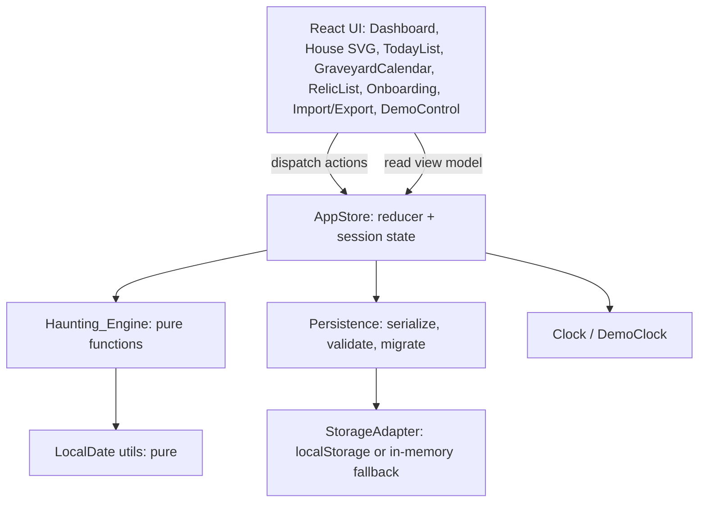
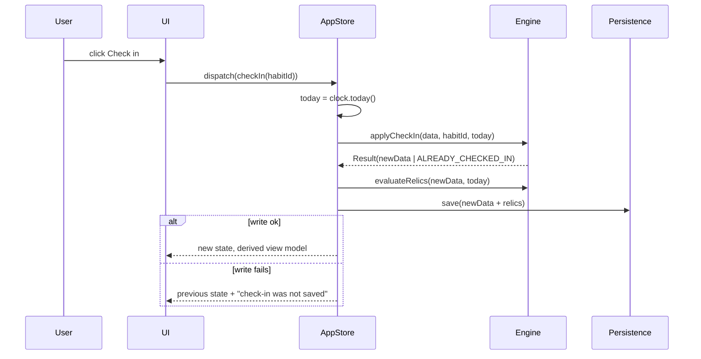

# Design Document: Habit Haunting

## Overview

Habit Haunting is a local-only, single-page web app. Each daily habit is a candle in a room of a haunted house. Check-ins grow the flame. Missed days grow a ghost that wanders through the house and darkens the habit's room. All derived state (streak, missed days, ghost level, ghost room, room darkness, haunted flag, relic eligibility, flame height) comes from pure functions of three inputs: habits, check-ins, and today's date. Nothing derived is trusted from storage.

### Key design decisions

| Decision | Choice | Rationale |
|---|---|---|
| Stack | TypeScript, Vite, React, SVG for the house | Static build, no backend. SVG scales and is easy to snapshot-test. |
| Persistence | `localStorage`, one JSON document under key `habit-haunting:v1`, behind a `StorageAdapter` interface | Data volume is small (limit 100 habits, 10,000 check-ins, a few MB at most). One key gives atomic writes and easy rollback. IndexedDB adds async complexity with no benefit. |
| Dates | Date-only strings `YYYY-MM-DD` (`LocalDate`), day arithmetic via civil day numbers | Never subtract `Date` timestamps, so 23 and 25 hour DST days cannot affect results (R10.3). |
| Time source | Injected `Clock` returning today's `LocalDate`; `DemoClock` wraps it with a day offset | The engine never calls `Date.now()`, so it is deterministic (R3.7, R9.4). |
| Derived state | Recomputed on every render, never persisted as the source of truth | Removes drift between check-ins and ghost state. The export contains a derived snapshot for completeness (R7.1). |
| Engine | Pure TypeScript module with no DOM, storage, or clock imports | Testable with property-based tests. |
| Testing | Vitest and fast-check | Each correctness property below maps to one fast-check test. |

### Research notes

- fast-check is the standard property-based testing library for TypeScript and integrates with Vitest. Generators (`fc.date`, `fc.array`, `fc.string`, `fc.record`) cover everything needed. It is a test-only dependency. See [fast-check docs](https://fast-check.dev/).
- JavaScript `Date` arithmetic on local timestamps is DST-unsafe: adding 24 hours across a DST change can land on the wrong calendar day. Converting `YYYY-MM-DD` to a day number with `Date.UTC(y, m-1, d) / 86400000` is exact because UTC has no DST. That is the approach here.
- `localStorage.setItem` throws `QuotaExceededError`, and may throw `SecurityError` when storage is blocked. Every write is wrapped in try/catch. The code must treat reads as untrusted input.

## Architecture



Layering rules:

1. `engine/` and `dates/` import nothing from React, the DOM, storage, or the clock. They take `today` as a parameter.
2. `store/` owns the session `AppData`, applies actions through pure reducers, then asks `persistence/` to write. If the write fails, the store keeps the in-memory change only when the failure is an environment failure (R9.5). For operations the requirements say must leave data unchanged (R1.8, R2.6, R4.5), the store rolls back to the previous state. See Error Handling.
3. `ui/` renders a `DashboardViewModel` produced by `engine/viewModel.ts`. Rendering functions contain no game rules.

### Data flow for a check-in



### Midnight and date changes

The store keeps `today` in session state. A timer set for the next local midnight, plus a `visibilitychange` handler and a 30-second safety poll, re-reads `clock.today()`. When the value changes, the store updates `today` and the view model is recomputed (R10.2, within 1 second of the rollover). The poll covers sleeping laptops where timers drift.

## Components and Interfaces

### Dates module (`dates/localDate.ts`)

```ts
type LocalDate = string; // "YYYY-MM-DD", validated by isLocalDate

isLocalDate(s: string): boolean            // format and real calendar date (rejects 2025-02-30)
toDayNumber(d: LocalDate): number          // Date.UTC(y, m-1, day) / 86400000
fromDayNumber(n: number): LocalDate
addDays(d: LocalDate, k: number): LocalDate
diffDays(a: LocalDate, b: LocalDate): number   // a - b in whole days
weekStartMonday(d: LocalDate): LocalDate
weekDays(d: LocalDate): LocalDate[]            // 7 dates Monday..Sunday containing d
localDateFromSystem(now: Date): LocalDate      // uses getFullYear/getMonth/getDate (local fields)
```

`localDateFromSystem` is the only function that reads local time fields. It lives in the Clock adapter, not in the engine.

### Clock (`clock/clock.ts`)

```ts
interface Clock { today(): LocalDate | null }  // null = date unavailable (R3.8)
systemClock: Clock
class DemoClock implements Clock { constructor(base: Clock); advanceOneDay(): void; offsetDays: number }
```

`DemoClock.today()` returns `addDays(base.today(), offsetDays)`. One call to `advanceOneDay` adds exactly 1 (R8.7). The offset is kept in session state and in a separate key `habit-haunting:demo-offset`, so it never enters the Export_File. Demo mode is on after loading the Demo_House or when the URL has `?demo=1`.

### Haunting_Engine (`engine/`)

All functions are pure and total over valid inputs.

```ts
validCheckIns(habit, checkIns, today): LocalDate[]
  // dates for this habit with isLocalDate, createdOn <= date <= today; de-duplicated; sorted ascending

streak(habit, checkIns, today): number
  // let v = set of valid check-in dates.
  // start = today if today in v; else yesterday if yesterday in v; else return 0.
  // count back one day at a time while date in v.

missedDays(habit, checkIns, today): number
  // v as above. If v is empty: diffDays(today, createdOn).
  // Else last = max(v): max(0, diffDays(today, last) - 1).
  // Today is never counted as missed because the day has not ended (R3.1).

ghostLevel(missed: number): number              // min(10, missed)
isHaunted(missed: number): boolean              // missed >= 3

flameHeight(streak: number): number             // computed, unbounded: FLAME_BASE + FLAME_STEP * streak
displayFlameHeight(streak: number): number      // min(flameHeight(streak), MAX_DISPLAY_HEIGHT)
hasFlame(habit, checkIns, today): boolean       // false only when there is no valid check-in (Unlit_Candle)

ghostSize(level: number): number                // 0 for level 0, else GHOST_SIZE_BASE + GHOST_SIZE_STEP * level
ghostOpacity(level: number): number             // 0 for level 0, else 0.1 + 0.09 * level
ghostStage(level: number): "none" | "home" | "hallway" | "attic" | "cellar"
ghostRoom(level: number, homeRoom: RoomId): RoomId | null

roomDarkness(totalMissed: number): number       // min(100, 10 * totalMissed)

evaluateRelics(data: AppData, today: LocalDate): { awarded: Relic[] }
applyCheckIn(data, habitId, today): Result<AppData, "ALREADY_CHECKED_IN" | "UNKNOWN_HABIT" | "INVALID_DATE">
addHabit / renameHabit / deleteHabit: Result<AppData, "NAME_REQUIRED" | "NAME_TOO_LONG" | "UNKNOWN_HABIT">
validateHabitName(raw: string): Result<string, "NAME_REQUIRED" | "NAME_TOO_LONG">   // trims, 1..100
sortRelics(relics): Relic[]                      // award date descending, ties by habitId then milestone
deriveHabitState(habit, checkIns, today): HabitState
buildDashboardViewModel(data, today): DashboardViewModel
buildDemoHouse(today): AppData
buildSeedHabits(today): AppData
```

#### Numeric definitions deferred by the requirements

**Ghost_Level (0 to 10).** `level = min(10, Missed_Days)`. It is an integer, never decreases as Missed_Days grows, and caps at 10 for every Missed_Days of 10 or more. The cap threshold is Missed_Days = 10.

**Haunted.** `Missed_Days >= 3`, which is Ghost_Level 3 or higher.

**Rooms.** The house has seven rooms in two groups.

| Room id | Name | Group | Holds candles |
|---|---|---|---|
| `parlor` | Parlor | home | yes |
| `library` | Library | home | yes |
| `kitchen` | Kitchen | home | yes |
| `bedroom` | Bedroom | home | yes |
| `hallway` | Hallway | haunt | no |
| `attic` | Attic | haunt | no |
| `cellar` | Cellar | haunt | no |

A new habit is assigned a home room when it is created: `HOME_ROOMS[(number of habits ever created) % 4]`, using a monotonic `nextRoomSeq` counter in the data so that deleting habits does not reassign rooms. The room is stored on the habit. Habits may share a room.

**Per-room ghost thresholds.** A ghost is always in exactly one room.

| Ghost_Level | Stage | Room shown |
|---|---|---|
| 0 | none | no ghost |
| 1 to 2 | home | the habit's home room |
| 3 to 5 | hallway | Hallway |
| 6 to 8 | attic | Attic |
| 9 to 10 | cellar | Cellar |

Thresholds are the level values 3, 6, and 9. The stage order home, hallway, attic, cellar is non-decreasing in level. The Haunted state (level 3) coincides with the ghost leaving its home room.

**Ghost size and opacity.** For level L from 1 to 10: `size = 24 + 8 * L` px (32 to 104), `opacity = 0.1 + 0.09 * L` (0.19 to 1.0). Level 0 shows no ghost. Both are strictly increasing in L, and opacity stays within 0.1 to 1.0. The opacity value is computed as `round(x * 100) / 100` to avoid float noise.

**Room darkness.** `darkness(room) = min(100, 10 * sum of Missed_Days of the habits whose home room is that room)`, as a percentage. It is 0 (lightest) with no missed days, increases by 10 for every added missed day, and stays at 100 once the sum reaches 10 (R3.5, R5.6). The sum uses raw Missed_Days, not the capped ghost level, so a room keeps darkening only until it saturates at 100. Haunt rooms (hallway, attic, cellar) hold no candles, so their darkness is always 0. This follows R3.5, which ties darkness to the room holding the candle.

**Flame height.** `computed = 10 + 4 * streak` (px units of the SVG viewBox). It is an integer, strictly increasing, and unbounded. `MAX_DISPLAY_HEIGHT = 120`. The displayed height is `min(computed, 120)`, which first reaches the clamp at streak 28 (computed 122). A streak of 0 with at least one past check-in shows the minimum flame, height 10. A habit with no valid check-in shows an Unlit_Candle, which has no flame.

The constants live in `engine/constants.ts`. The UI reads them from there and never repeats the numbers.

### Reducer and store (`store/`)

```ts
type Action =
  | { type: "addHabit"; name: string }
  | { type: "renameHabit"; habitId: string; name: string }
  | { type: "deleteHabit"; habitId: string }
  | { type: "checkIn"; habitId: string }
  | { type: "importData"; data: AppData }
  | { type: "loadDemo" }
  | { type: "completeOnboarding" };

interface AppStore {
  getState(): SessionState;
  dispatch(a: Action): Promise<DispatchOutcome>;  // { ok } | { error: ErrorCode, message }
  setToday(d: LocalDate | null): void;            // called by the clock watcher
  retryLoad(): void;
}
```

Each `dispatch` runs the pure reducer, then `persistence.save`. On a failed save the store applies the rollback rules in Error Handling.

### Persistence (`persistence/`)

```ts
interface StorageAdapter { get(key: string): string | null; set(key: string, value: string): void; remove(key: string): void }
class LocalStorageAdapter implements StorageAdapter
class MemoryStorageAdapter implements StorageAdapter    // used when localStorage is unavailable (R9.5)

load(adapter): { kind: "empty" } | { kind: "ok", data: AppData } | { kind: "corrupt", raw: string }
save(adapter, data): Result<void, "WRITE_FAILED">
serialize(data): string      // canonical JSON (sorted arrays and fixed key order)
parseAppData(json: string): Result<AppData, "NOT_JSON" | "BAD_STRUCTURE">
```

A `corrupt` load starts the app with empty in-memory state and a message. The stored raw value is not touched until the first create/change, at which point it is overwritten (R9.6).

### Import and export (`transfer/`)

```ts
buildExport(data: AppData, today: LocalDate, exportedAt: string): ExportFile
serializeExport(file: ExportFile): string            // canonical JSON, stable key order
parseExport(text: string): Result<ExportFile, "NOT_JSON" | "BAD_STRUCTURE">
importToAppData(file: ExportFile): AppData
```

Import flow: file picked, `parseExport`, on error show message and stop. On success show a confirmation prompt. The store is modified only after the user confirms (R7.6). Cancel discards the file (R7.7).

### UI components

| Component | Responsibility |
|---|---|
| `Dashboard` | Lays out House, TodayList, GraveyardCalendar. Shows load error with retry. |
| `HouseView` | SVG of all seven rooms, candles, flames, ghosts, darkness overlay. Selecting a candle opens `CandleDetail`. |
| `CandleDetail` | Habit name, streak, missed days. |
| `TodayList` | Every habit with checked/not-checked status and a Check in button. |
| `GraveyardCalendar` | Monday to Sunday grid, one row per habit, cells checked, missed, or blank. |
| `HabitForm` | Add and edit with inline validation messages. Delete with confirmation. |
| `RelicList` | Relics newest first, or empty-state message. |
| `Onboarding` | Creates the three Seed_Habits, offers "Load Demo House". |
| `TransferPanel` | Export button, import file picker, confirmation dialog. |
| `DemoControl` | Shown in demo mode. One button "Next day" calls `advanceOneDay`. |
| `Banner` | Persistent error and info messages (storage failure, invalid date, corrupt data). |

Animations use CSS transitions of 300 ms or less so that visual updates complete inside the 500 ms requirements.

## Data Models

```ts
type RoomId = "parlor" | "library" | "kitchen" | "bedroom" | "hallway" | "attic" | "cellar";
type Milestone = 7 | 30;

interface Habit {
  id: string;            // uuid (crypto.randomUUID), unique
  name: string;          // trimmed, 1..100 chars
  frequency: "daily";
  createdOn: LocalDate;
  homeRoom: RoomId;      // one of the four home rooms
}

interface CheckIn { habitId: string; date: LocalDate }   // unique per (habitId, date) after applyCheckIn

interface Relic { habitId: string; milestone: Milestone; awardedOn: LocalDate }  // unique per (habitId, milestone)

interface AppData {
  schemaVersion: 1;
  habits: Habit[];
  checkIns: CheckIn[];
  relics: Relic[];
  nextRoomSeq: number;   // monotonic counter for home room assignment
}

interface HabitState {           // derived, never stored
  streak: number;
  missedDays: number;
  ghostLevel: number;
  ghostRoom: RoomId | null;
  haunted: boolean;
  flameComputed: number;
  flameDisplayed: number;
  lit: boolean;
}

interface DashboardViewModel {
  today: LocalDate;
  rooms: { id: RoomId; darkness: number; candles: CandleVM[]; ghosts: GhostVM[] }[];
  todayList: { habitId: string; name: string; checkedIn: boolean }[];
  week: { days: LocalDate[]; rows: { habitId: string; cells: ("checked" | "missed" | "none")[] }[] };
  isEmpty: boolean;
}
```

### Calendar cell rule (R5.4)

For habit H and day D in the displayed week: `none` if `D > today` or `D < H.createdOn`; otherwise `checked` if a check-in exists for (H, D), else `missed`. Today with no check-in is shown as `missed` by this rule. The cell for today is displayed as pending in the UI only through the Today_List, so the calendar keeps the two-mark rule from the requirements.

### Storage layout

Key `habit-haunting:v1` holds `JSON.stringify(AppData)`. Key `habit-haunting:demo-offset` holds an integer string. Unknown `schemaVersion` values are treated as corrupt data.

### Export schema (`ExportFile`, version 1)

```json
{
  "format": "habit-haunting-export",
  "version": 1,
  "exportedAt": "2025-03-09T14:05:00.000Z",
  "asOfDate": "2025-03-09",
  "nextRoomSeq": 5,
  "habits": [
    { "id": "…", "name": "Read", "frequency": "daily", "createdOn": "2025-02-01", "homeRoom": "library" }
  ],
  "checkIns": [ { "habitId": "…", "date": "2025-03-08" } ],
  "relics": [ { "habitId": "…", "milestone": 7, "awardedOn": "2025-02-08" } ],
  "ghosts": [
    { "habitId": "…", "missedDays": 0, "ghostLevel": 0, "ghostRoom": null, "haunted": false, "streak": 12 }
  ]
}
```

Rules:

- `exportedAt` is the only field ignored in round-trip comparisons (R7.3). `asOfDate` is the date the derived `ghosts` entries were computed for.
- Arrays are sorted canonically: habits by `createdOn` then `id`, check-ins by `habitId` then `date`, relics by `habitId` then `milestone`, ghosts by `habitId`. Object keys are written in fixed order. This makes export, import, export byte-equal apart from `exportedAt` when the clock is the same.
- `ghosts` and `streak` are a derived snapshot. On import the app does not trust them. It recomputes derived state from habits and check-ins with the current date. A validator rule checks the snapshot is well-formed, not that it matches.
- Validation (hand-written, no dependency): `format` and `version` match; every habit has a unique string id, a 1 to 100 character trimmed name, `frequency` equal to `daily`, a valid `createdOn`, and a home room from the four home rooms; every check-in references an existing habit and has a valid date; relics have milestone 7 or 30 and reference existing habits with at most one per (habit, milestone); counts are within 100 habits and 10,000 check-ins is a performance target only, not a validation limit. Any failure returns `BAD_STRUCTURE`. Text that does not parse as JSON returns `NOT_JSON`. The error message names which of the two occurred (R7.5).
- Import preserves `Relics` and check-ins as given, including check-ins with out-of-range dates, which the engine excludes at compute time (R10.6). This keeps import then export equal.

### Seed habits and Demo house

`buildSeedHabits(today)` creates three habits named "Drink water", "Move for 10 minutes", and "Read 10 pages", with `createdOn = today`, in home rooms parlor, library, and kitchen, with no check-ins. Onboarding is a single "Start" action, so it fits within 5 actions (R8.2).

`buildDemoHouse(today)` creates five habits, all created 30 days before `today`, so the output depends only on `today`:

| Habit | Last check-in | Missed_Days | Notes |
|---|---|---|---|
| Meditate | 6 days ago | 5 | Haunted, ghost in hallway |
| Exercise | 11 days ago | 10 | Haunted, level 10, cellar |
| Journal | 3 days ago | 2 | Not haunted, ghost in home room |
| Drink water | today, and a 12-day run ending today | 0 | Streak 12 |
| Stretch | 4 days ago | 3 | Haunted at the threshold |

Each habit's check-ins are a contiguous run ending on its last check-in date, which keeps the data consistent with the engine. Habit counts are 5, inside the 3 to 6 range. Three are Haunted.

## Correctness Properties

*A property is a characteristic or behavior that should hold true across all valid executions of a system-essentially, a formal statement about what the system should do. Properties serve as the bridge between human-readable specifications and machine-verifiable correctness guarantees.*

### Property 1: Habit name validation and edit semantics

*For any* string `s`, `validateHabitName(s)` succeeds if and only if `s` trimmed has 1 to 100 characters, and then returns the trimmed string. *For any* app data, adding a habit with a valid name stores the trimmed name, `frequency = "daily"`, and the given creation date. Renaming with a valid name changes only that habit's name and leaves its check-ins and creation date unchanged. Adding or renaming with an invalid name returns an error and leaves the data equal to the input.

**Validates: Requirements 1.1, 1.3, 1.4, 1.5, 1.6**

### Property 2: Delete removes all traces of a habit

*For any* app data and any existing habit, after deleting that habit no habit, check-in, or relic references its id, and all other habits, check-ins, and relics are unchanged.

**Validates: Requirements 1.7**

### Property 3: Date arithmetic is exact and time-zone independent

*For any* valid `LocalDate` `d` and integer `k` in a range of plus or minus 100,000 days, `diffDays(addDays(d, k), d) = k`, `addDays(addDays(d, k), -k) = d`, `addDays(d, 1)` is the next calendar date, and `weekDays(d)` is 7 consecutive dates from Monday to Sunday containing `d`. The same results are produced when the suite runs under `TZ` set to `America/New_York`, `Europe/London`, and `Pacific/Auckland`.

**Validates: Requirements 10.1, 10.3, 5.3**

### Property 4: Engine outputs are deterministic and well-formed

*For any* habit, check-in list, and valid today, `streak` is an integer greater than or equal to 0 and `missedDays` is an integer greater than or equal to 0. Computing `deriveHabitState` twice, or with the check-in list in any permutation or with duplicate entries added, gives deeply equal results.

**Validates: Requirements 2.5, 3.7, 9.4**

### Property 5: Out-of-range check-ins are ignored

*For any* habit, check-ins, and today, adding any number of check-ins dated before the habit's creation date or after today leaves `streak`, `missedDays`, `ghostLevel`, and the derived state unchanged, and returns no error. The stored list is not modified by the computation.

**Validates: Requirements 10.6**

### Property 6: Check-in post-conditions

*For any* app data, habit, and today where the habit has no check-in for today, `applyCheckIn` adds exactly one check-in for that habit and date, the new streak equals the old streak plus 1, the new `missedDays` is 0, the new `ghostLevel` is 0 and no ghost is shown, the habit is not haunted, and when the old `ghostLevel` was greater than 0 the new level is strictly lower and the ghost size and opacity are less than or equal to the old values.

**Validates: Requirements 2.1, 2.3, 3.6, 4.3, 8.6**

### Property 7: Duplicate check-in is a no-op

*For any* app data and habit that already has a check-in for today, `applyCheckIn` returns `ALREADY_CHECKED_IN` and the data is equal to the input.

**Validates: Requirements 2.4**

### Property 8: Missing a day adds one missed day

*For any* habit and check-ins with no check-in on today or after, `missedDays(today + 1) = missedDays(today) + 1`, provided the habit has no check-in on today and today is on or after the creation date.

**Validates: Requirements 3.1**

### Property 9: Ghost level mapping

*For any* integer `n >= 0`, `ghostLevel(n)` is an integer in 0 to 10, `ghostLevel(n + 1) >= ghostLevel(n)`, and `ghostLevel(n) = 10` for every `n >= 10`.

**Validates: Requirements 3.2, 10.5**

### Property 10: Ghost size and opacity

*For any* level `L` from 1 to 10, `ghostSize(L)` and `ghostOpacity(L)` are strictly greater than `ghostSize(L - 1)` for `L >= 2` and `ghostOpacity(L - 1)` respectively, and `0.1 <= ghostOpacity(L) <= 1.0`. Level 0 produces no ghost.

**Validates: Requirements 3.3, 5.6**

### Property 11: Ghost placement is a single room with non-decreasing stage

*For any* level from 0 to 10 and any home room, `ghostRoom` returns exactly one valid room (or none at level 0). The stage index (home, hallway, attic, cellar) is non-decreasing in level, and the room changes exactly at levels 3, 6, and 9.

**Validates: Requirements 3.4**

### Property 12: Room darkness

*For any* non-negative total of missed days `t`, `roomDarkness(t)` is in 0 to 100, `roomDarkness(0) = 0`, `roomDarkness(t + 1) >= roomDarkness(t)`, and `roomDarkness(t) = 100` for every `t >= 10`. *For any* app data, a room's darkness equals `roomDarkness` of the sum of Missed_Days of the habits whose home room is that room.

**Validates: Requirements 3.5, 5.6**

### Property 13: Flame height

*For any* integer streak `n >= 0` (including values far above the display clamp), `flameHeight(n + 1) > flameHeight(n)`, and `displayFlameHeight(n) = min(flameHeight(n), 120)`, which is non-decreasing in `n` and never exceeds 120. The computed value is the same whether or not a display clamp is applied.

**Validates: Requirements 2.2, 2.7, 5.6, 10.4**

### Property 14: Haunted threshold

*For any* integer `n >= 0`, `isHaunted(n)` is true if and only if `n >= 3`. *For any* habit state transition where Missed_Days goes from 2 or fewer to 3 or more, the habit becomes haunted.

**Validates: Requirements 4.1, 4.6**

### Property 15: Today list and week view

*For any* app data and today, the Today_List contains every habit exactly once, and each entry's `checkedIn` is true if and only if a valid check-in exists for today. The displayed week has 7 days, Monday to Sunday, and contains today.

**Validates: Requirements 5.2, 5.3**

### Property 16: Graveyard cell marking

*For any* habit, check-ins, today, and day `D` in the displayed week, the cell is `none` if `D > today` or `D < createdOn`, and otherwise is `checked` if a check-in exists for `D` and `missed` if not. Each cell has exactly one of the three values.

**Validates: Requirements 5.4**

### Property 17: Relic award

*For any* app data and sequence of check-in and date-advance operations, after each evaluation there is at most one relic per (habit, milestone). A relic for milestone `m` exists for a habit if its streak has reached at least `m` at some evaluated date. Evaluating repeatedly with the same data awards nothing new. Relics already awarded keep their milestone and award date through streak resets and later evaluations.

**Validates: Requirements 6.1, 6.2, 6.3, 6.5**

### Property 18: Relic list ordering

*For any* list of relics, `sortRelics` returns the same elements ordered by `awardedOn` descending.

**Validates: Requirements 6.4**

### Property 19: Export and import round trip

*For any* valid app data and fixed today, exporting, parsing, importing, and exporting again gives a file equal to the first apart from `exportedAt`. The imported data has the same streaks, ghost levels, and relics as the original at that date. The export contains every habit, check-in, relic, and one ghost entry per habit.

**Validates: Requirements 7.1, 7.2, 7.3, 7.4**

### Property 20: Invalid import is rejected without side effects

*For any* text that is not valid JSON, or any valid JSON that does not match the export structure (including exports with a field removed, a field of the wrong type, a duplicate habit id, or a check-in for an unknown habit), `parseExport` returns an error whose code distinguishes `NOT_JSON` from `BAD_STRUCTURE`, and the stored data is unchanged.

**Validates: Requirements 7.5**

### Property 21: Persistence round trip

*For any* valid app data, `load(save(data))` yields data deeply equal to the original, so every restored record has field values equal to those before the reload.

**Validates: Requirements 9.1, 9.2**

### Property 22: Demo house shape

*For any* valid today, `buildDemoHouse(today)` has 3 to 6 habits, at least one with Missed_Days of 3 or more, and the same output for the same `today`.

**Validates: Requirements 8.4**

### Property 23: Demo date control

*For any* base date and any number `k >= 0` of single-step advances, the demo clock returns `addDays(base, k)`. After each advance the derived state for every habit equals the state computed directly for that date.

**Validates: Requirements 8.7, 8.8**

## Error Handling

| Condition | Source | Behavior |
|---|---|---|
| Empty or whitespace name, name over 100 chars | R1.3, 1.4, 1.6 | Inline message ("A name is required" / "Names can be at most 100 characters"). Data unchanged. |
| Write fails on add, edit, delete | R1.8 | Roll back to the previous state, banner "The change could not be saved". |
| Duplicate check-in | R2.4 | Message "Already checked in today". Data unchanged. |
| Write fails on check-in | R2.6, R4.5 | Roll back to the previous state (habit stays haunted if it was), banner "Check-in was not saved". |
| Date unavailable (`clock.today()` is null) or not a valid calendar date | R3.8 | The store's `DateGuard` validates today with `isLocalDate` before recomputing. Engine functions are not called. Show "The date is invalid". Keep the last good view and leave derived values unchanged. The guard looks only at today and never at check-in dates, so backward clock changes do not trigger it. |
| Check-in dated before the habit's creation date or after today (including future-dated check-ins from imports or backward clock changes) | R10.6 | Engine excludes it silently. No error, and the dashboard keeps working. |
| Relic write fails | R6.6 | Relic is not added to the displayed list. Banner "Relic could not be saved". Evaluation runs again on every evaluation while streak is at or above the milestone, so the award is retried. |
| Dashboard load takes more than 5 seconds | R5.8 | Timer in the loader shows error and a Retry button. Previously shown data stays. |
| Invalid import file | R7.5 | Message says "not valid JSON" or "does not match the export structure". Store untouched. |
| Import write fails | R7.8 | The previous raw string is saved before writing. On failure it is written back, and the import-failed message is shown. If the restore also fails, the in-memory state is the previous state and a banner says data could not be saved. |
| Demo load fails | R8.5 | Previous raw data is retained. Message "The Demo House could not be loaded". |
| Storage unavailable, or write fails for an operation without a rollback rule | R9.5 | The app switches to `MemoryStorageAdapter`, keeps the in-memory change, and shows a banner within 2 seconds saying data could not be saved. All features keep working for the session. |
| Stored data unreadable at load | R9.6 | Start empty, banner "Stored data could not be loaded". The raw value stays until the first create or change. |

## Testing Strategy

Property-based testing applies here because the engine, date utilities, validators, and import/export are pure functions with large input spaces. UI rendering, storage failure handling, and timers use example-based tests, since they are side-effect or rendering concerns.

### Property-based tests

- Library: [fast-check](https://fast-check.dev/) with Vitest. No hand-rolled property framework.
- Every property above is implemented by exactly one property-based test, configured with `numRuns: 100` or more.
- Each test carries a comment tag in the format `Feature: habit-haunting, Property {number}: {property text}`.
- Shared generators in `test/arbitraries.ts`: `localDate` (years 1970 to 2100, including leap days and DST change dates), `habitName` (arbitrary unicode with padding whitespace), `appData` (up to 20 habits, check-ins that include duplicates, out-of-range dates, and gaps), `exportFile`, and `corruptedExport` (mutations of a valid export: removed field, wrong type, duplicate id, dangling reference, truncated text).
- Property 3 runs under three `TZ` values through separate Vitest projects (`TZ=America/New_York`, `Europe/London`, `Pacific/Auckland`). The engine is also tested against a lint rule that forbids `Date.now`, `new Date()` without arguments, and `Math.random` in `engine/` and `dates/`.
- Failing seeds are printed by fast-check and recorded as regression examples.

### Unit and example-based tests

- Habit add shows an Unlit_Candle (R1.2) and the empty dashboard message (R5.7).
- Storage failure injection with a throwing `StorageAdapter` for R1.8, R2.6, R4.5, R6.6, R7.8, R8.5, and R9.5, including rollback assertions.
- Import confirmation: the store is untouched until confirm, and cancel discards the file (R7.6, R7.7).
- Onboarding creates three seed habits in a single action and shows the demo option (R8.1 to R8.3).
- Corrupted stored data: starts empty, raw value untouched until the first change (R9.6).
- Midnight rollover with fake timers and an injected clock (R10.2).
- Display of the haunted ghost and its removal after revival (R4.2, R4.4), candle detail contents (R5.5), empty relic list (R6.7), load timeout and retry with fake timers (R5.8).
- Concrete DST examples: dates around 2025-03-09 and 2025-11-02 in America/New_York, and 2025-03-30 and 2025-10-26 in Europe/London give streaks and missed days equal to the same dates in a no-DST zone.
- Concrete engine tables for `ghostLevel`, `ghostStage`, `roomDarkness`, and `flameHeight` at boundary values (0, 2, 3, 5, 6, 8, 9, 10, 11 missed days; streak 0, 27, 28, 29).

### Smoke and performance tests

- Network spy: no `fetch`, `XMLHttpRequest`, `sendBeacon`, or WebSocket calls occur during a full session (R9.3). The build has no backend or analytics dependency.
- Export of 100 habits and 10,000 check-ins finishes within 2 seconds, and import within 5 seconds (R7.1, R7.2). These are timed once in a test with a generous margin.
- Interaction timing requirements (500 ms, 1 s, 2 s) are met by synchronous recomputation and CSS transitions of 300 ms or less. They are checked by component tests that assert the DOM is updated in the same tick as the dispatch, not by wall-clock assertions.

### Coverage map

Requirements 1.2, 1.8, 2.6, 4.2, 4.4, 4.5, 5.1, 5.5, 5.7, 5.8, 6.6, 6.7, 7.6 to 7.8, 8.1 to 8.3, 8.5, 8.6, 9.3, 9.5, 9.6, and 10.2 are covered by example, integration, or smoke tests. All other acceptance criteria are covered by Properties 1 to 23.
